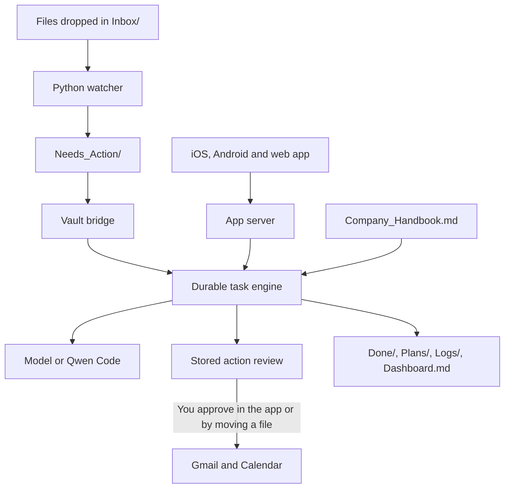

# Personal AI Employee (Digital FTE)

> **Your life and business on autopilot. Local-first, agent-driven, human-in-the-loop.**

A personal AI employee that picks up work from your files and Obsidian vault, carries it out as durable tasks, and waits for your approval before it does anything external. You can follow and control it from Obsidian or from the iOS, Android and web app.

[](app/LICENSE)

The app in [`app/`](app/) is built from [OpenMuse](https://github.com/CopilotKit/openmuse) (MIT, upstream commit `a4944f4`).

## Overview

A Digital FTE works like an employee, with these target economics:

| Feature | Human FTE | Digital FTE |
|---------|-----------|-------------|
| Availability | 40 hours/week | **168 hours/week (24/7)** |
| Monthly Cost | $4,000 - $8,000+ | **$50 - $200** (API costs) |
| Ramp-up Time | 3-6 months | **Instant** |
| Scaling | Linear (hire more) | **Exponential (duplicate instantly)** |
| Cost per Task | ~$5.00 | **~$0.50** |

## How it works



The app server owns all task state and every external action. The vault is an input queue and a readable view of that state, so there is only one task system and one approval system.

| Part | Location | Role |
|------|----------|------|
| Watcher | `AI_Employee_Vault/src/` | Turns dropped files into action files in `Needs_Action/` |
| Vault | `AI_Employee_Vault/` | Obsidian notes, Company Handbook, Dashboard and workflow folders |
| Vault bridge | `app/apps/server/src/vault.ts` | Connects the vault folders to the task engine every 5 seconds |
| Task engine | `app/apps/server/src/engine/` | Runs tasks with retries, recovery, pause, resume and cancel |
| Qwen backend | `app/apps/server/src/engine/qwen.ts` | Optional task runner using the Qwen Code CLI |
| Client | `app/apps/mobile/` | Shared iOS, Android and web app |
| Browser worker | `app/apps/worker/` | Persistent Chromium sessions |
| Linux computer | `app/apps/computer/` | Optional isolated Docker workspace |

## Features

- **File intake:** drop a file in `Inbox/` and it becomes a task, oldest first.
- **Approvals:** emails and calendar changes wait for your decision, in the app or the vault.
- **Company Handbook:** your rules apply to chat and to delegated tasks. They can add caution, but they never remove a review.
- **Chat and delegated tasks:** visible plans, progress, questions, retries and saved results.
- **Gmail and Calendar:** read, search and reviewed writes, using your own Google OAuth client.
- **Browser and Linux computer:** public-page reading, take-over sessions, terminal and workspace files.
- **Documents and finance:** PDF viewing and form filling, and spending summaries from a transaction CSV.
- **Goals and tracking:** goals, milestones, source-backed ideas, and recurring public-page checks.
- **Vault view:** results, plans, logs and live status written back to Obsidian.

Full details are in the [app README](app/README.md) and the [feature inventory](app/docs/FEATURES.md).

## Quick start

### Prerequisites

| Component | Version | Needed for |
|-----------|---------|------------|
| Node.js | 24 LTS | The app |
| pnpm | 11.19.0 | The app |
| Python | 3.13+ | The watcher |
| CopilotKit Intelligence project key | n/a | The app will not start without one |
| Obsidian | v1.10.6+ | Optional, for browsing the vault |
| Qwen Code | Latest | Optional, for `TASK_BACKEND=qwen` |
| Docker | Latest | Optional, for the Linux computer or container browser |

### 1. Set up and start the app

```bash
cd app
pnpm install --frozen-lockfile
cp .env.example .env
npx copilotkit@latest login
npx copilotkit@latest project select
# Set CPK_INTELLIGENCE_API_KEY in .env, and keep the generated CPK_TELEMETRY_ID
pnpm dev
```

In a second terminal, from `app/`:

```bash
pnpm dev:web
```

Open [localhost:8081](http://localhost:8081). The API is at [localhost:8787/api/health](http://localhost:8787/api/health).

The default configuration uses fictional sample data and needs no model or Google account.

### 2. Start the watcher

In a third terminal, from the repository root:

```bash
pip install -r AI_Employee_Vault/src/requirements.txt
cd AI_Employee_Vault/src
python filesystem_watcher.py ..
```

### 3. Try it

Delegated tasks need a backend, so set one in `app/.env` and restart `pnpm dev`:

```bash
# Either a model
MODEL=openai/your-model-id
OPENAI_API_KEY=your-key

# Or Qwen Code
TASK_BACKEND=qwen
```

Then drop a file in the inbox from the repository root:

```bash
echo "What is 2+2? Answer briefly." > AI_Employee_Vault/Inbox/test.txt
```

The result appears in `AI_Employee_Vault/Done/` as `RESPONSE_<file>`, and the task appears in the app.

## Using the vault

| Folder or file | Purpose |
|----------------|---------|
| `Inbox/` | Drop files here |
| `Needs_Action/` | Action files waiting to be picked up |
| `In_Progress/` | Files whose tasks are running |
| `Pending_Approval/` | `REVIEW_*.md` files waiting for your decision |
| `Approved/` | Move a review here to execute it |
| `Rejected/` | Move a review here to decline it |
| `Done/` | Finished items, `RESPONSE_*` results and completed reviews |
| `Plans/` | `PLAN_*` copies of task plans |
| `Logs/` | Daily logs, `EXEC_*` receipts, `ERROR_*` reports and `Failed_Executions/` |
| `Dashboard.md` | Live status, between the `fte:status` markers |
| `Company_Handbook.md` | Your standing rules |

Editing a review file does not change what is sent. The stored action runs exactly as prepared, and a file with the wrong action ID or hash is refused and moved to `Logs/Failed_Executions/`.

Reviews expire after 30 minutes. An expired review is moved to `Logs/Failed_Executions/`, and nothing is sent.

Hand-written files in `Approved/` are handled by their `type`:

| Type | Result |
|------|--------|
| `email` | Becomes a stored review, so it still needs approval |
| `email` with `action: draft` | Saved as a draft in the app, not in Gmail |
| `whatsapp` | Logged for you to send manually |
| Anything else | Logged, with a note that nothing was done |

## Configuration

Settings live in `app/.env`. See [`app/.env.example`](app/.env.example) for the full list.

| Variable | Default | Purpose |
|----------|---------|---------|
| `VAULT_PATH` | `../AI_Employee_Vault` in `.env.example` | Vault location. Unset it to run without the vault |
| `TASK_BACKEND` | `model` | Delegated task runner: `model` or `qwen` |
| `QWEN_COMMAND` | `qwen` | Command used to start Qwen Code |
| `MODEL` | none | Provider and model, such as `openai/your-model-id` |
| `AGENT_BACKEND` | `sample` | Chat backend. Use `model` for real conversation |
| `WORKSPACE_MODE` | `sample` | Use `live` for your real Google account |
| `COMPUTER_ENABLED` | `false` | Enables the Docker Linux computer |
| `WEB_SEARCH_ENABLED` | `true` | Enables web search through Parallel |

Live Google accounts, the browser worker, the Linux computer and deployment are covered in the [app README](app/README.md).

### Qwen Code

`TASK_BACKEND=qwen` applies to open-ended delegated tasks. Chat still uses `AGENT_BACKEND`.

Qwen runs without `-y` and gets each task over stdin, so a headless run cannot take actions on its own. It finishes with a result, a question, or a requested action that waits for your review.

This backend has been tested with a stand-in command, not the real Qwen CLI.

### Privacy

The vault stays on your machine, but some features use outside services:

| Service | What it receives | Control |
|---------|------------------|---------|
| CopilotKit Intelligence | Chat threads | Required in every mode |
| CopilotKit telemetry | Runtime usage | `DO_NOT_TRACK=1` or `COPILOTKIT_TELEMETRY_DISABLED=true` |
| Parallel web search | Model-generated queries and context | `WEB_SEARCH_ENABLED=false` |
| Your model provider | Task and chat content | Your choice of `MODEL` |

## Development

Run these from `app/`:

```bash
pnpm lint
pnpm typecheck
pnpm --dir apps/worker typecheck
pnpm test
pnpm build:server

# One test file
pnpm exec tsx --import ./tests/setup.ts --test tests/vault-bridge.test.ts
```

On Windows without symlink privileges, `worker recovery preserves downloads when metadata cannot be inspected` fails with `EPERM`.

To add a watcher, subclass `BaseWatcher` in `AI_Employee_Vault/src/`, implement `check_for_updates()` and `create_action_file()`, and write Markdown files to `Needs_Action/`. The vault bridge picks them up from there.

See [CONTRIBUTING.md](app/CONTRIBUTING.md) for the app's change guidelines.

## Project structure

```
Personal-AI-FTE/
├── app/                    # App server, clients, workers and tests
├── AI_Employee_Vault/      # Obsidian vault and Python watcher
│   ├── Company_Handbook.md
│   ├── Dashboard.md
│   └── src/
├── .github/                # CI and Renovate configuration
├── render.yaml             # Render deployment
├── QWEN.md                 # Qwen Code context
└── Personal AI Employee Hackathon 0_ Building Autonomous FTEs in 2026.md
```

The vault's workflow folders are created when the server runs. They are not committed, because they can hold private data.

## Current limitations

- The filesystem watcher is the only watcher in this repository. The Gmail and WhatsApp watchers described in older notes are not included.
- The filesystem watcher only sees files dropped while it is running.
- GitHub CI, Render deployment and Renovate have been moved to the repository root but have not been run from there.
- WhatsApp messages are logged for manual sending, and payment or other unknown action types are not executed.

## Roadmap

| Tier | Status | Remaining work |
|------|--------|----------------|
| **Bronze** | Complete | None |
| **Silver** | Partial | Gmail and WhatsApp watchers, Task Scheduler setup |
| **Gold** | Partial | Odoo accounting, social media, persistent multi-step loop, weekly CEO briefing |
| **Platinum** | Not started | Always-on cloud deployment, work-zone specialization, vault sync |

The full blueprint is in [`Personal AI Employee Hackathon 0_ Building Autonomous FTEs in 2026.md`](Personal%20AI%20Employee%20Hackathon%200_%20Building%20Autonomous%20FTEs%20in%202026.md), and the app's own plans are in [`app/ROADMAP.md`](app/ROADMAP.md).

## License

MIT. See [`app/LICENSE`](app/LICENSE) for the OpenMuse license. OpenMuse's fictional assets are included, and CopilotKit Intelligence is a separate service that this license does not cover.
